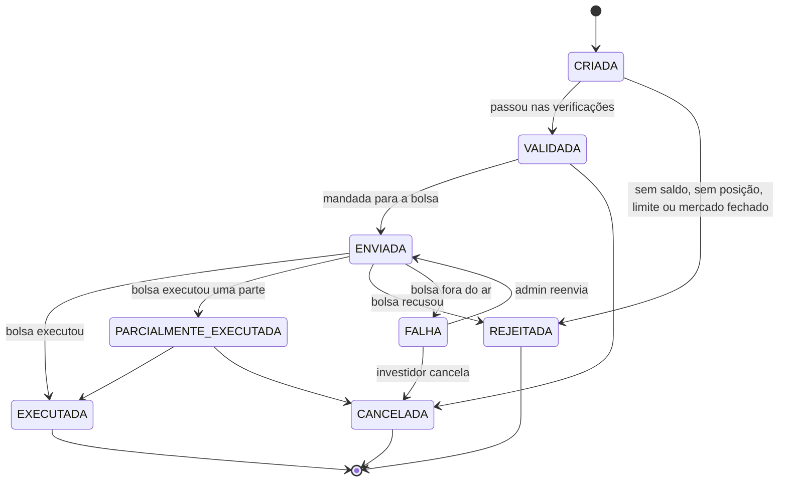
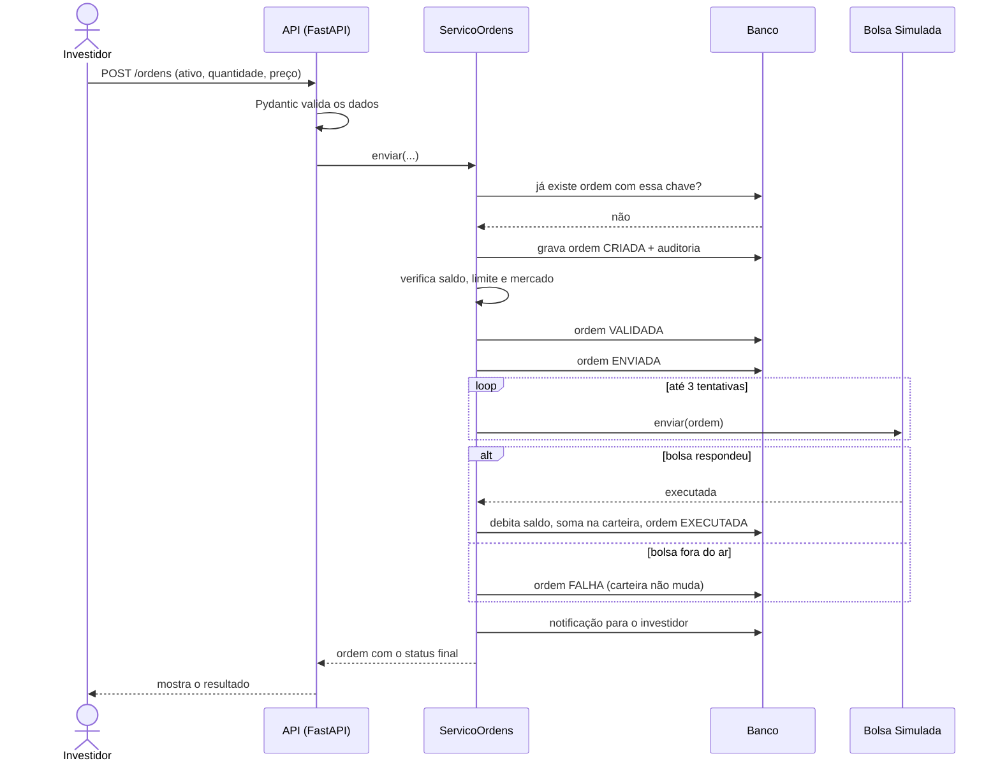
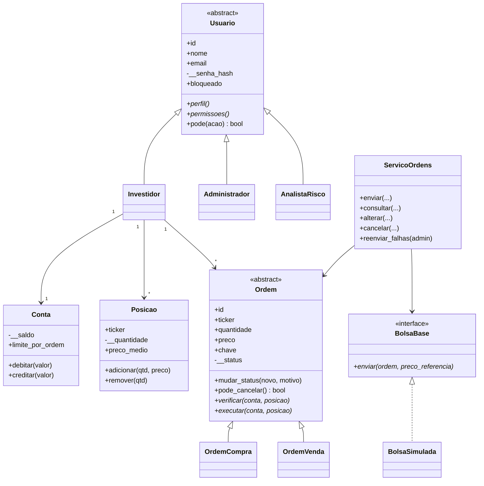
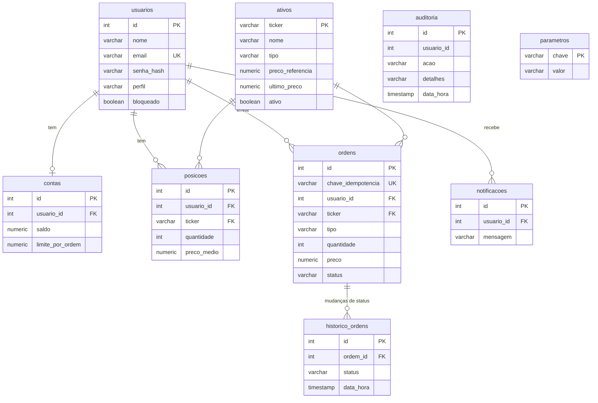

# Diagramas do SentinelTrade

- **Casos de uso (UMLsec):** imagem em [`../docs/uml/diagrama-casos-de-uso.png`](../docs/uml/diagrama-casos-de-uso.png), código PlantUML em [`diagrama-casos-de-uso.puml`](diagrama-casos-de-uso.puml).
- Os diagramas abaixo usam **Mermaid**

## 1. Estados da Ordem

Código: `TRANSICOES` em `src/sentineltrade/dominio.py`. EXECUTADA, REJEITADA e CANCELADA não mudam mais (RN-04).

## 2. Sequência — Enviar Ordem de Compra (UC-05)

## 3. Classes

## 4. Banco de Dados (PostgreSQL)
Script: [`database/schema.sql`](../database/schema.sql) · Dados de exemplo: [`database/seed.sql`](../database/seed.sql)

- `chave_idempotencia` é `UNIQUE`: o banco não deixa gravar a mesma ordem duas vezes.
- A tabela `auditoria` tem uma trigger que impede `UPDATE` e `DELETE`.
- Dinheiro usa `NUMERIC(15,2)`.