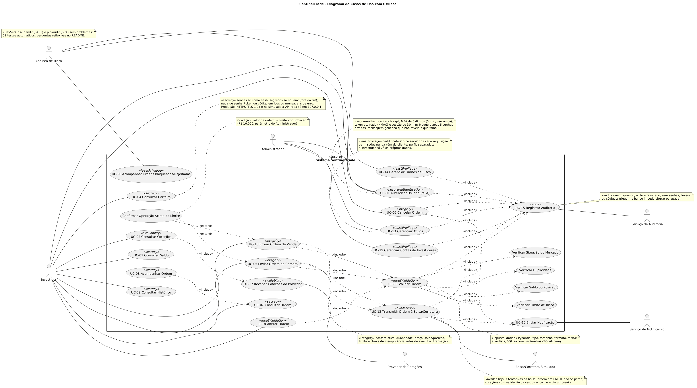

# Evidências — SentinelTrade

## Estrutura de pastas

```
.
├── README.md, .gitignore, .env.example, requirements.txt, main.py
├── docs/requisitos/     requisitos.md, regras-de-negocio.md, matriz-rastreabilidade.md
├── docs/casos-de-uso/   especificacao-casos-de-uso.md
├── docs/uml/            diagrama-casos-de-uso.png (UMLsec)
├── docs/evidencias/     evidencias.md (este arquivo)
├── database/            schema.sql, seed.sql
├── diagrams/            diagrama-casos-de-uso.puml, diagramas.md
├── src/sentineltrade/   api.py, servicos.py, dominio.py, persistencia.py, integracoes.py
└── tests/               test_dominio.py, test_sistema.py
```

## Arquivos iniciais

README.md, .gitignore, .env.example (só os nomes das variáveis, sem senha), requisitos, especificação dos casos de uso, diagrama e scripts do banco.

## Histórico de commits

Depois de todos os commits, gerar e colar aqui:

```bash
git log --format="%h | %an | %ad | %s" --date=short
git shortlog -sn HEAD
```

## Participação dos integrantes

| Integrante | Commits | Parte do trabalho |
|---|---|---|
| Beatriz Paulino Gomes | (preencher) | (preencher) |
| Carolina Viana Belam | (preencher) | (preencher) |
| Sarah Krybus Chalom | (preencher) | (preencher) |

## Diagrama de casos de uso (UMLsec)



## Testes automáticos — 44 testes, todos OK (com PostgreSQL)

Comando: `python -m unittest discover -s tests -t . -v`

```
test_compra_atualiza_saldo_e_preco_medio (tests.test_dominio.TestCompraEVenda.test_compra_atualiza_saldo_e_preco_medio) ... ok
test_compra_sem_saldo (tests.test_dominio.TestCompraEVenda.test_compra_sem_saldo) ... ok
test_venda_sem_posicao (tests.test_dominio.TestCompraEVenda.test_venda_sem_posicao) ... ok
test_caminho_normal (tests.test_dominio.TestEstados.test_caminho_normal) ... ok
test_estados_finais_nao_mudam (tests.test_dominio.TestEstados.test_estados_finais_nao_mudam) ... ok
test_falha_e_reenvio (tests.test_dominio.TestEstados.test_falha_e_reenvio) ... ok
test_nao_pula_etapas (tests.test_dominio.TestEstados.test_nao_pula_etapas) ... ok
test_quem_pode_cancelar (tests.test_dominio.TestEstados.test_quem_pode_cancelar) ... ok
test_investidor (tests.test_dominio.TestValidacoes.test_investidor) ... ok
test_ordem_valida (tests.test_dominio.TestValidacoes.test_ordem_valida) ... ok
test_preco_invalido (tests.test_dominio.TestValidacoes.test_preco_invalido) ... ok
test_quantidade_invalida (tests.test_dominio.TestValidacoes.test_quantidade_invalida) ... ok
test_ticker_invalido (tests.test_dominio.TestValidacoes.test_ticker_invalido) ... ok
test_tipo_de_ativo (tests.test_dominio.TestValidacoes.test_tipo_de_ativo) ... ok
test_tipo_invalido (tests.test_dominio.TestValidacoes.test_tipo_invalido) ... ok
test_confirmacao_acima_do_limite (tests.test_sistema.TestApi.test_confirmacao_acima_do_limite) ... ok
test_dados_invalidos_retornam_422 (tests.test_sistema.TestApi.test_dados_invalidos_retornam_422) ... ok
test_investidor_nao_acessa_admin (tests.test_sistema.TestApi.test_investidor_nao_acessa_admin) ... ok
test_login_e_compra (tests.test_sistema.TestApi.test_login_e_compra) ... ok
test_sem_login_nao_entra (tests.test_sistema.TestApi.test_sem_login_nao_entra) ... ok
test_ativo_suspenso (tests.test_sistema.TestOrdens.test_ativo_suspenso) ... ok
test_bolsa_rejeita_preco_muito_diferente (tests.test_sistema.TestOrdens.test_bolsa_rejeita_preco_muito_diferente) ... ok
test_circuit_breaker_das_cotacoes (tests.test_sistema.TestOrdens.test_circuit_breaker_das_cotacoes) ... ok
test_compra_executada (tests.test_sistema.TestOrdens.test_compra_executada) ... ok
test_compra_sem_saldo_rejeitada (tests.test_sistema.TestOrdens.test_compra_sem_saldo_rejeitada) ... ok
test_confirmacao_acima_de_10_mil (tests.test_sistema.TestOrdens.test_confirmacao_acima_de_10_mil) ... ok
test_dados_invalidos (tests.test_sistema.TestOrdens.test_dados_invalidos) ... ok
test_historico_e_auditoria (tests.test_sistema.TestOrdens.test_historico_e_auditoria) ... ok
test_limite_de_risco (tests.test_sistema.TestOrdens.test_limite_de_risco) ... ok
test_mercado_fechado (tests.test_sistema.TestOrdens.test_mercado_fechado) ... ok
test_mesma_chave_nao_duplica (tests.test_sistema.TestOrdens.test_mesma_chave_nao_duplica) ... ok
test_nao_mexe_na_ordem_de_outro (tests.test_sistema.TestOrdens.test_nao_mexe_na_ordem_de_outro) ... ok
test_notificacao (tests.test_sistema.TestOrdens.test_notificacao) ... ok
test_ordem_executada_nao_cancela (tests.test_sistema.TestOrdens.test_ordem_executada_nao_cancela) ... ok
test_venda_executada (tests.test_sistema.TestOrdens.test_venda_executada) ... ok
test_venda_sem_posicao_rejeitada (tests.test_sistema.TestOrdens.test_venda_sem_posicao_rejeitada) ... ok
test_admin_nao_envia_ordem (tests.test_sistema.TestSeguranca.test_admin_nao_envia_ordem) ... ok
test_auditoria_nao_pode_ser_apagada (tests.test_sistema.TestSeguranca.test_auditoria_nao_pode_ser_apagada) ... ok
test_codigo_mfa_errado (tests.test_sistema.TestSeguranca.test_codigo_mfa_errado) ... ok
test_codigo_usado_uma_vez (tests.test_sistema.TestSeguranca.test_codigo_usado_uma_vez) ... ok
test_hash_da_senha (tests.test_sistema.TestSeguranca.test_hash_da_senha) ... ok
test_investidor_nao_acessa_funcoes_de_admin (tests.test_sistema.TestSeguranca.test_investidor_nao_acessa_funcoes_de_admin) ... ok
test_login_com_mfa (tests.test_sistema.TestSeguranca.test_login_com_mfa) ... ok
test_token_alterado_ou_expirado (tests.test_sistema.TestSeguranca.test_token_alterado_ou_expirado) ... ok
Ran 51 tests in 9.494s
OK
```

## bandit (análise de segurança do código)

Comando: `bandit -r src main.py`

```
[main]	INFO	profile include tests: None
[main]	INFO	profile exclude tests: None
[main]	INFO	cli include tests: None
[main]	INFO	cli exclude tests: None
[main]	INFO	running on Python 3.13.18

Test results:
	No issues identified.

Code scanned:
	Total lines of code: 926
	Total lines skipped (#nosec): 0
	Total potential issues skipped due to specifically being disabled (e.g., #nosec BXXX): 1

Run metrics:
	Total issues (by severity):
		Undefined: 0
		Low: 0
		Medium: 0
		High: 0
	Total issues (by confidence):
		Undefined: 0
		Low: 0
		Medium: 0
		High: 0
Files skipped (0):
```

## pip-audit (vulnerabilidades nas bibliotecas)

Comando: `pip-audit -r requirements.txt`

```
No known vulnerabilities found
```

## Prints

Salvar em `docs/evidencias/` os prints da estrutura do repositório, da aba de commits, dos commits de cada integrante, dos testes passando e da página `/docs` da API.
