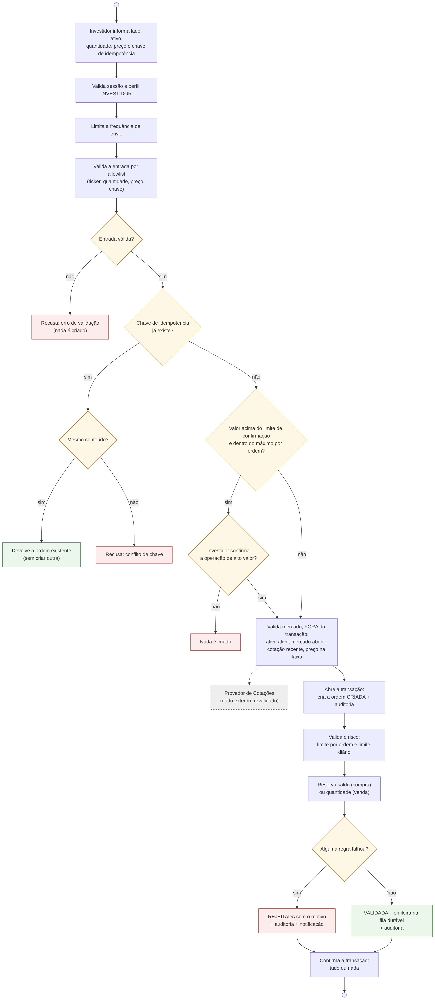
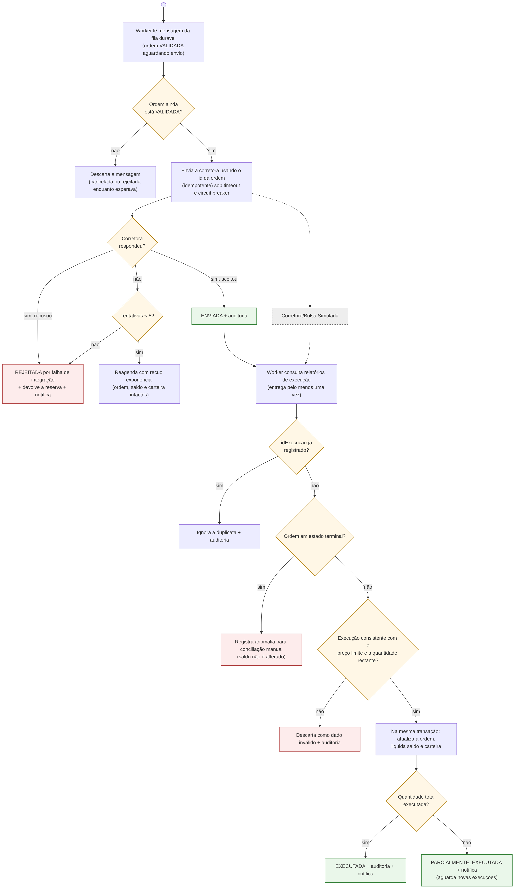
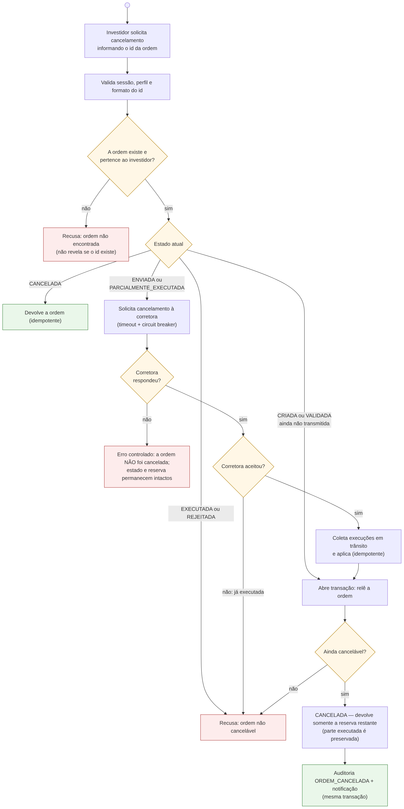
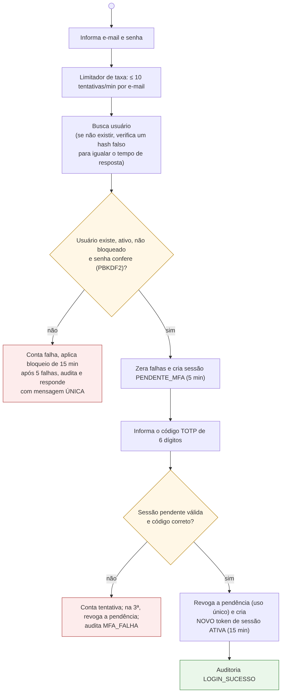
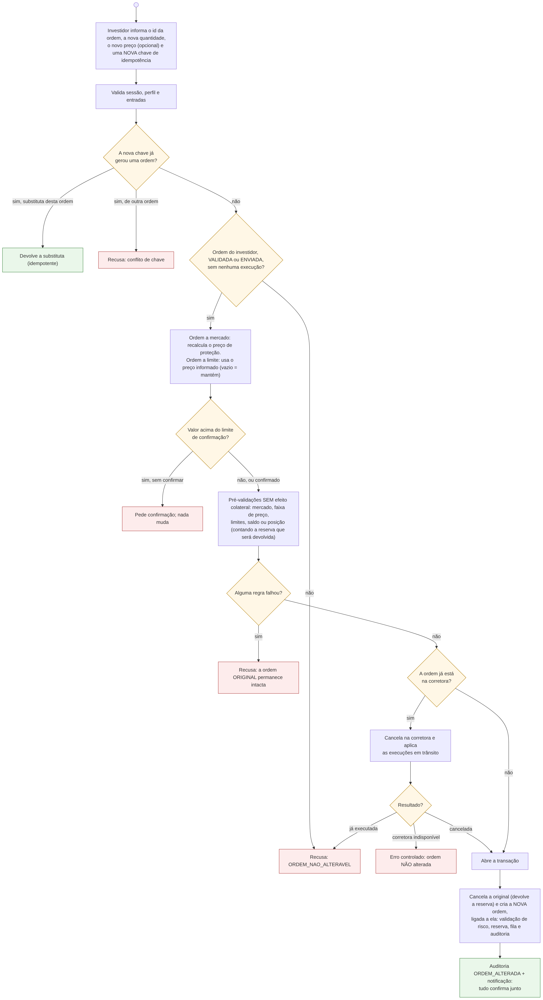

# UML — Diagramas de atividades

Fontes editáveis em Mermaid (`*.mmd`, renderizam direto no GitHub); exportações em `diagrams/`.

## 1. Enviar ordem — validação síncrona (UC05/UC06)
Mostra a ordem das validações e **onde ocorre a transação**: a validação de mercado (que depende de sistemas externos)
fica **fora** da transação de banco; criação da ordem, risco, reserva, fila e auditoria confirmam **juntos**.

Fonte: [`enviar-ordem-validacao.mmd`](enviar-ordem-validacao.mmd)

## 2. Transmissão e liquidação — assíncrono (UC12/UC17)
Worker, corretora e liquidação idempotente. Destaque para os desvios de falha: retentativa com recuo, esgotamento,
duplicata, ordem terminal e execução inconsistente.

Fonte: [`transmissao-e-liquidacao.mmd`](transmissao-e-liquidacao.mmd)

## 3. Cancelar ordem (UC13)

Fonte: [`cancelar-ordem.mmd`](cancelar-ordem.mmd)

## 4. Autenticação com MFA (UC01)

Fonte: [`autenticacao-mfa.mmd`](autenticacao-mfa.mmd)

## 5. Alterar ordem — cancelar e substituir (UC25)
Destaque: as **pré-validações sem efeito colateral** vêm antes de qualquer cancelamento; por isso, se algo impedir a nova
ordem, a original continua intacta. O cancelamento da original e a criação da nova ocorrem na mesma transação.

Fonte: [`alterar-ordem.mmd`](alterar-ordem.mmd)
