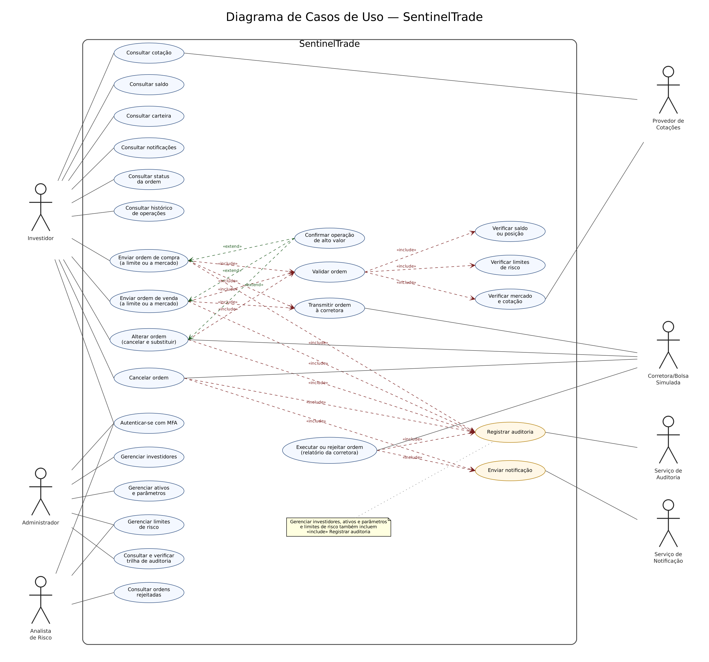

# UML — Casos de uso

Fonte editável: [`gerar_casos_de_uso.py`](gerar_casos_de_uso.py) produz [`casos-de-uso.dot`](casos-de-uso.dot) (Graphviz, posições fixas) e a imagem, e **verifica geometricamente que nenhuma linha atravessa uma elipse alheia** (`python3 gerar_casos_de_uso.py`, dentro desta pasta; requer Graphviz e Pillow). Versão anterior (Fase 1): [`diagrams/legado/`](../../../diagrams/legado/DiagramaUML-v1-casos-de-uso.png).

## O que mudou em relação à versão da Fase 1

| Problema que identificamos na versão anterior | Como corrigimos nesta versão |
|---|---|
| Na versão anterior, tínhamos apenas 3 dos 7 atores (faltavam Administrador, Analista de Risco, Serviço de Notificação e Serviço de Auditoria). | Incluímos os **7 atores** do enunciado. |
| Sem MFA, sem "Consultar saldo", sem "Gerenciar ativos/limites". | Incluídos: **Autenticar-se com MFA**, Consultar saldo, Gerenciar ativos e parâmetros, Gerenciar limites de risco, Gerenciar investidores. |
| "Enviar ordem" genérico. | **Enviar ordem de compra** e **de venda** separados (regras diferentes: saldo × posição). |
| "Validar ordem" sem detalhar o que valida. | `Validar ordem` «include» **Verificar saldo ou posição**, **Verificar limites de risco** e **Verificar mercado e cotação**. |
| «include» invertido: "Transmitir ordem" incluía "Acompanhar ciclo de vida". | Enviar ordem «include» Validar ordem, Transmitir ordem à corretora e Registrar auditoria. O ciclo de vida é *consequência* (processamento de execuções), não parte da transmissão. |
| Notificação ligada ao Investidor como se ele a executasse. | `Enviar notificação` é executada pelo **Serviço de Notificação** e incluída por *Cancelar* e *Executar/rejeitar*. |
| Sem «extend». | **Confirmar operação de alto valor** «extend» Enviar ordem (comportamento condicional: valor acima do limite de confirmação). |
| Imagem hospedada fora do repositório e não editável. | Diagrama **versionado e editável** no repositório. |
| Linhas atravessando elipses. | As linhas são ancoradas nas pontas laterais das elipses e o gerador **verifica** (45 linhas, 0 cruzamentos). |
| «Gerenciar limites de risco» ligado só ao Analista, ou só ao Administrador. | Os **dois** são ligados, como a tabela de atores do enunciado define (Administrador gerencia limites; Analista consulta e ajusta). O RF15 e o código seguem a mesma regra; o investidor não tem acesso. |

## Casos de uso

| # | Caso de uso | Ator principal | Atores de apoio | Requisitos |
|---|---|---|---|---|
| UC01 | Autenticar-se com MFA | Investidor, Administrador, Analista | — | RF01, RF02 |
| UC02 | Consultar saldo | Investidor | — | RF03 |
| UC03 | Consultar carteira | Investidor | — | RF03 |
| UC04 | Consultar cotação | Investidor | Provedor de Cotações | RF04 |
| UC05 | **Enviar ordem de compra** (a limite ou a mercado) | Investidor | — | RF05, RF08, RF22 |
| UC06 | **Enviar ordem de venda** (a limite ou a mercado) | Investidor | — | RF06, RF08, RF22 |
| UC07 | Validar ordem *(incluído)* | — | Provedor de Cotações | RF08 |
| UC08 | Verificar saldo ou posição *(incluído)* | — | — | RF05, RF06 |
| UC09 | Verificar limites de risco *(incluído)* | — | — | RF08, RF15 |
| UC10 | Verificar mercado e cotação *(incluído)* | — | Provedor de Cotações | RF08 |
| UC11 | Confirmar operação de alto valor *(«extend» de UC05, UC06 e UC25)* | Investidor | — | RF18 |
| UC12 | Transmitir ordem à corretora *(incluído; assíncrono)* | Sistema (worker) | Corretora/Bolsa | RF16 |
| UC13 | **Cancelar ordem** | Investidor | Corretora/Bolsa | RF07 |
| UC14 | Consultar status da ordem | Investidor | — | RF09 |
| UC15 | Consultar histórico de operações | Investidor | — | RF14 |
| UC16 | Consultar notificações | Investidor | — | RF11 |
| UC17 | Executar ou rejeitar ordem (relatório da corretora) | Sistema | Corretora/Bolsa | RF17 |
| UC18 | Gerenciar investidores | Administrador | — | RF13, RF20 |
| UC19 | Gerenciar ativos e parâmetros | Administrador | — | RF12 |
| UC20 | Gerenciar limites de risco | Administrador, Analista de Risco | — | RF15 |
| UC21 | Consultar ordens rejeitadas | Analista de Risco | — | RF19 |
| UC22 | Consultar e verificar trilha de auditoria | Administrador | — | RF10 |
| UC23 | Enviar notificação *(incluído)* | — | Serviço de Notificação | RF11 |
| UC24 | Registrar auditoria *(incluído)* | — | Serviço de Auditoria | RF10 |
| UC25 | **Alterar ordem** (cancelar e substituir) | Investidor | Corretora/Bolsa | RF21 |

---

## Descrição textual dos casos de uso críticos

### UC05 — Enviar ordem de compra

| Campo | Conteúdo |
|---|---|
| **Nome** | Enviar ordem de compra |
| **Ator principal** | Investidor |
| **Objetivo** | Comprar uma quantidade de um ativo a um preço limite, com o valor reservado e a ordem rastreável e sem duplicidade. |
| **Pré-condições** | Investidor autenticado com MFA e sessão ativa; conta e limites de risco existentes; chave de idempotência gerada pelo cliente para esta intenção. |
| **Fluxo principal** | 1. Investidor informa ativo, quantidade, preço limite e a chave de idempotência. 2. Sistema valida a sessão, o perfil e a frequência de envio. 3. Sistema valida a entrada por *allowlist* (ticker, quantidade, preço, chave). 4. Sistema verifica que a chave ainda não foi usada. 5. Sistema valida mercado: ativo ativo, mercado aberto, cotação recente, preço dentro da faixa *(UC10)*. 6. Em **uma transação**: cria a ordem CRIADA; valida limites de risco *(UC09)*; reserva saldo = quantidade × preço *(UC08)*; marca VALIDADA; enfileira para transmissão; registra auditoria *(UC24)*. 7. Sistema devolve a ordem VALIDADA ao investidor. 8. *(Assíncrono)* O worker transmite à corretora *(UC12)* e processa as execuções *(UC17)*. |
| **Fluxos alternativos** | **A1 – Entrada inválida (passo 3):** recusa com erro de validação; nada é criado. **A2 – Chave já usada (4):** com o mesmo conteúdo, devolve a ordem existente (sem reservar de novo); com conteúdo diferente, recusa por conflito. **A3 – Alto valor (antes do 5):** valor acima do limite de confirmação → pede confirmação *(UC11)*; sem confirmar, nada é criado. **A4 – Saldo insuficiente (6):** ordem REJEITADA (`SALDO_INSUFICIENTE`), auditada e notificada; saldo intacto. **A5 – Ativo indisponível / mercado fechado / cotação desatualizada ou ausente / preço fora da faixa / limite excedido (5–6):** ordem REJEITADA com o código correspondente. **A6 – Falha de comunicação com a corretora (8):** a ordem permanece VALIDADA na fila e é retentada com recuo exponencial; esgotadas 5 tentativas, REJEITADA (`FALHA_INTEGRACAO`) e a reserva é devolvida. **A7 – Provedor de cotações fora do ar (5):** usa a última cotação válida enquanto recente; senão rejeita. |
| **Pós-condições** | **Sucesso:** ordem VALIDADA, saldo disponível reduzido e saldo bloqueado aumentado no mesmo valor, mensagem na fila, eventos de auditoria gravados. **Rejeição:** ordem REJEITADA com motivo, nenhuma reserva, auditoria e notificação. **Em qualquer caso:** nenhuma ordem duplicada. |
| **Regras de negócio** | RN01, RN03, RN09–RN16, RN19, RN23, RN25 |
| **Requisitos relacionados** | RF05, RF08, RF09, RF10, RF11, RF16, RF18; RNF02, RNF04, RNF06, RNF11 |

### UC06 — Enviar ordem de venda

| Campo | Conteúdo |
|---|---|
| **Nome** | Enviar ordem de venda |
| **Ator principal** | Investidor |
| **Objetivo** | Vender uma quantidade de um ativo da própria carteira a um preço limite, sem vender mais do que possui nem vender a mesma quantidade duas vezes. |
| **Pré-condições** | As mesmas do UC05; posição do ativo na carteira. |
| **Fluxo principal** | Igual ao UC05, exceto o passo 6: em vez de reservar saldo, o sistema **bloqueia a quantidade** na posição (quantidade disponível = total − bloqueada). Na execução, a quantidade bloqueada é baixada, o **custo médio é preservado proporcionalmente** e o valor da venda é creditado no saldo. |
| **Fluxos alternativos** | **A1 – Posição insuficiente:** ordem REJEITADA (`POSICAO_INSUFICIENTE`); nada é bloqueado. **A2 – Venda em dobro:** uma segunda venda sobre quantidade já reservada é rejeitada. **A3–A7:** idênticos aos do UC05 (entrada inválida, chave repetida, alto valor, ativo/mercado/cotação/faixa/limite, falha da corretora, provedor fora do ar). |
| **Pós-condições** | **Sucesso:** ordem VALIDADA, quantidade bloqueada na posição. **Após execução total:** posição reduzida, custo total reduzido proporcionalmente, saldo creditado. **Rejeição/cancelamento:** quantidade desbloqueada. |
| **Regras de negócio** | RN02, RN03, RN09–RN16, RN17, RN19 |
| **Requisitos relacionados** | RF06, RF08, RF09, RF10, RF11, RF16, RF17; RNF02, RNF06 |

### UC13 — Cancelar ordem

| Campo | Conteúdo |
|---|---|
| **Nome** | Cancelar ordem |
| **Ator principal** | Investidor (Corretora/Bolsa como ator de apoio) |
| **Objetivo** | Desistir de uma ordem ainda não totalmente executada, recuperando a reserva do que não foi executado. |
| **Pré-condições** | Investidor autenticado; a ordem existe e **pertence a ele**. |
| **Fluxo principal** | 1. Investidor informa o id da ordem. 2. Sistema valida sessão, perfil e formato do id; confirma que a ordem é do investidor. 3. Sistema verifica o estado: se CRIADA/VALIDADA (ainda não transmitida), segue para 6. 4. Se ENVIADA/PARCIALMENTE_EXECUTADA, solicita o cancelamento à corretora. 5. A corretora aceita; o sistema coleta e aplica as execuções que estavam em trânsito. 6. Em **uma transação**: relê a ordem, marca CANCELADA, **devolve somente a reserva restante** (a parte já executada é preservada), registra auditoria *(UC24)* e cria notificação *(UC23)*. 7. Sistema devolve a ordem CANCELADA. |
| **Fluxos alternativos** | **A1 – Ordem de outro investidor ou inexistente (2):** "ordem não encontrada" (indistinguíveis). **A2 – EXECUTADA ou REJEITADA (3):** recusa (`ORDEM_NAO_CANCELAVEL`). **A3 – Já CANCELADA (3):** devolve a ordem (idempotente; nada é devolvido de novo). **A4 – Corretora indisponível (4):** erro controlado; **a ordem NÃO é cancelada** e mantém estado e reserva. **A5 – Corretora informa que já executou tudo (5):** recusa; as execuções são aplicadas. |
| **Pós-condições** | **Sucesso:** ordem CANCELADA (estado terminal); reserva restante devolvida; execução parcial preservada; auditoria e notificação registradas. **Falha:** ordem e reserva inalteradas. |
| **Regras de negócio** | RN04, RN05, RN07, RN08, RN16, RN24 |
| **Requisitos relacionados** | RF07, RF09, RF10, RF11; RNF04, RNF08, RNF11 |

### UC25 — Alterar ordem (cancelar e substituir)

| Campo | Conteúdo |
|---|---|
| **Nome** | Alterar ordem |
| **Ator principal** | Investidor (Corretora/Bolsa como ator de apoio) |
| **Objetivo** | Mudar a quantidade e/ou o preço de uma ordem ainda não executada, sem perdê-la se a mudança for impossível. |
| **Pré-condições** | Investidor autenticado; a ordem é dele, está VALIDADA ou ENVIADA e **não teve nenhuma execução**; nova chave de idempotência gerada para esta alteração. |
| **Fluxo principal** | 1. Investidor informa o id, a nova quantidade, o novo preço (opcional) e a chave. 2. Sistema valida sessão, perfil e entradas; verifica que a chave ainda não foi usada. 3. Em ordem a mercado, recalcula o preço de proteção; em ordem a limite, usa o preço informado (vazio = mantém). 4. Se o novo valor exceder o limite de confirmação, pede confirmação *(UC11)*. 5. **Pré-valida sem efeito colateral:** mercado, faixa de preço, limites e saldo/posição (contando a reserva que será devolvida) *(UC07)*. 6. Se a ordem já está na corretora, cancela lá e aplica as execuções em trânsito. 7. Em **uma transação**: cancela a original (devolve a reserva), cria a nova ordem ligada a ela (validação, reserva, fila) e registra auditoria *(UC24)* e notificação *(UC23)*. 8. Sistema devolve a original CANCELADA e a nova ordem. |
| **Fluxos alternativos** | **A1 – Ordem não alterável (2):** parcialmente executada, executada, rejeitada ou cancelada → `ORDEM_NAO_ALTERAVEL`. **A2 – Chave repetida (2):** se já gerou a substituta desta ordem, devolve-a (idempotente); se é de outra ordem, conflito. **A3 – Alto valor sem confirmação (4):** nada muda. **A4 – Pré-validação falha (5):** recusa; **a ordem original permanece intacta**. **A5 – Corretora indisponível (6):** erro controlado; ordem inalterada. **A6 – Corretora informa que já executou (6):** recusa. |
| **Pós-condições** | **Sucesso:** original CANCELADA com a reserva devolvida; nova ordem VALIDADA (ou REJEITADA com motivo, se uma regra mudar entre a pré-validação e a transação), reserva da nova, auditoria e notificação. **Falha prévia:** nada muda. |
| **Regras de negócio** | RN16, RN24, RN27–RN30 |
| **Requisitos relacionados** | RF21, RF22, RF09, RF10; RNF06, RNF11 |

### UC01 — Autenticar-se com MFA

| Campo | Conteúdo |
|---|---|
| **Ator principal** | Investidor, Administrador ou Analista de Risco |
| **Pré-condições** | Usuário cadastrado e ativo; segredo MFA provisionado. |
| **Fluxo principal** | 1. Informa e-mail e senha. 2. Sistema limita a frequência, verifica o hash PBKDF2 e cria sessão **PENDENTE_MFA** (5 min). 3. Informa o código TOTP de 6 dígitos. 4. Sistema valida, consome a pendência e cria **novo** token de sessão ATIVA (15 min). 5. Registra auditoria. |
| **Fluxos alternativos** | **A1** credencial inválida/conta bloqueada: mensagem única; falhas contadas (5 → bloqueio de 15 min). **A2** código errado: 3 tentativas e a pendência é revogada. **A3** pendência expirada. |
| **Pós-condições** | Sessão ATIVA com o perfil do usuário; tentativas e acessos auditados. |
| **Regras / requisitos** | RN20–RN22 · RF01, RF02, RNF01 |
