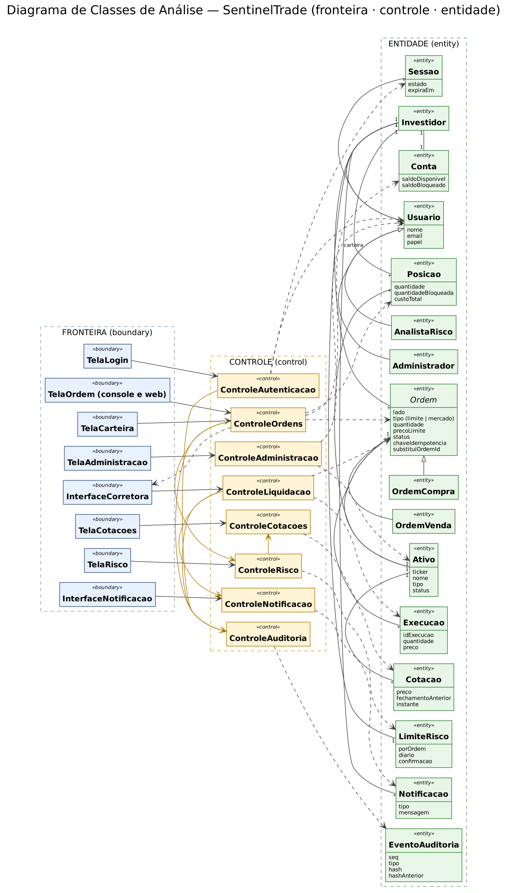

# UML — Classes de análise

Modelo **conceitual**, independente de tecnologia, no estilo **fronteira · controle · entidade** (BCE):

- **Fronteira (boundary):** o que o ator enxerga/usa (telas, interfaces com sistemas externos).
- **Controle (control):** a lógica de cada caso de uso (quem coordena).
- **Entidade (entity):** os conceitos persistentes do negócio.

Fonte: [`classes-analise.dot`](classes-analise.dot) · gerador: [`../gerar_diagramas_graphviz.py`](../gerar_diagramas_graphviz.py)

## Como a análise virou projeto

| Análise | Projeto (código) | Decisão |
|---|---|---|
| `Investidor`, `Administrador`, `AnalistaRisco` (especializações de `Usuario`) | `Usuario` + enum `Papel` | A especialização só muda **permissões**, não dados: um enum simplifica a persistência e o controle de acesso (RBAC). |
| `ControleOrdens`, `ControleLiquidacao` | `OrdemService`, `ProcessadorOrdens` | Separados porque um é síncrono (requisição do usuário) e o outro assíncrono (worker). |
| `ControleRisco`, `ControleCotacoes` | `ValidadorOrdem`, `CotacaoService`, `RiscoService` | O risco foi dividido em validação de mercado (fora da transação) e de limites (dentro). |
| `ControleAuditoria`, `ControleNotificacao` | `AuditoriaService`, `NotificacaoService` | Notificação em duas etapas (*outbox*); auditoria na mesma transação do fato. |
| `Posicao` (carteira) | `Posicao` | Carteira = conjunto de posições por ativo. |
| `Execucao` | `Execucao` (com `idExecucao` da corretora) | O identificador externo viabiliza a idempotência. |
| Telas | `CliApp` | Interface de console; a regra de negócio nunca mora nela. |
