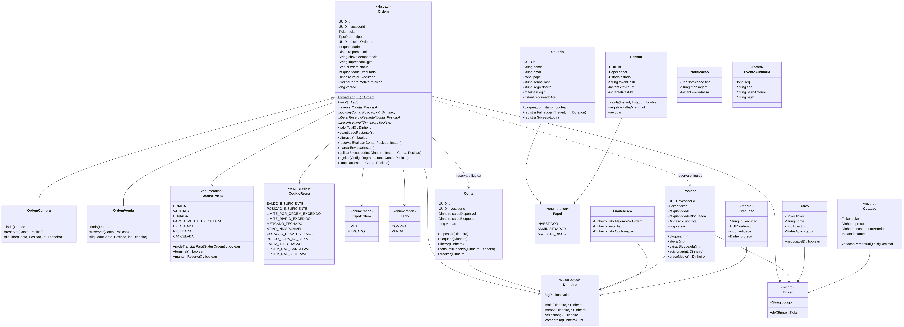
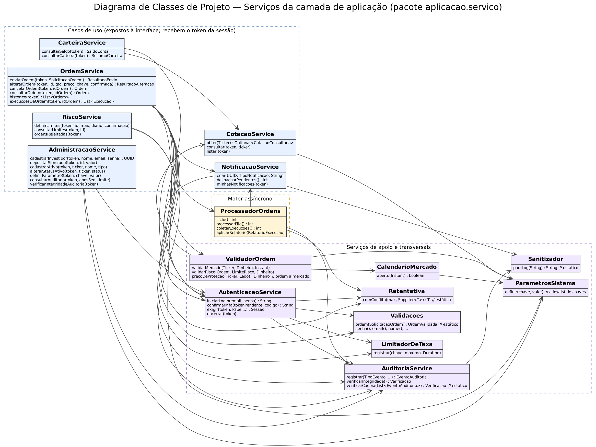
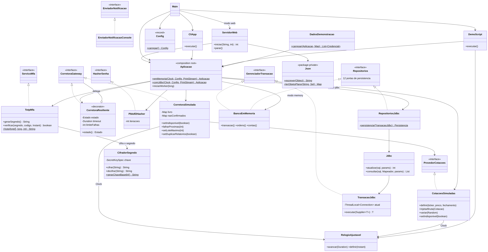

# UML — Classes de projeto

Refletem o código Java (pacote `br.orion.sentineltrade`). Três visões, uma por camada.

## 1. Domínio (`dominio`)
`Ordem` é **abstrata**: `OrdemCompra` e `OrdemVenda` especializam reserva, liquidação e liberação (polimorfismo),
então nenhum serviço precisa de `if (lado == COMPRA)` para mexer em saldo ou posição. `StatusOrdem` concentra a tabela de transições.
`Dinheiro` e `Ticker` são objetos de valor que **validam na construção** (entrada inválida nunca vira objeto). `TipoOrdem` (LIMITE/MERCADO) e `substituiOrdemId` suportam a ordem a mercado e a alteração (cancelar e substituir).

Fonte: [`dominio.mmd`](dominio.mmd)

## 2. Serviços de aplicação (`aplicacao.servico`)

Fonte: [`servicos.dot`](servicos.dot) · gerador: [`../gerar_diagramas_graphviz.py`](../gerar_diagramas_graphviz.py)

### Dependências dos serviços em relação às portas (`aplicacao.porta`)

| Serviço | Portas que utiliza |
|---|---|
| `OrdemService` | `GerenciadorTransacao`, `OrdemRepositorio`, `ContaRepositorio`, `PosicaoRepositorio`, `LimiteRiscoRepositorio`, `ExecucaoRepositorio`, `FilaOrdens`, `CorretoraGateway` |
| `ProcessadorOrdens` | `FilaOrdens`, `CorretoraGateway`, `OrdemRepositorio`, `ContaRepositorio`, `PosicaoRepositorio`, `ExecucaoRepositorio`, `GerenciadorTransacao` |
| `AutenticacaoService` | `UsuarioRepositorio`, `SessaoRepositorio`, `HasherSenha`, `ServicoMfa`, `GerenciadorTransacao` |
| `AuditoriaService` | `AuditoriaRepositorio` |
| `NotificacaoService` | `NotificacaoRepositorio`, `EnviadorNotificacao` |
| `CotacaoService` | `ProvedorCotacoes`, `AtivoRepositorio` |
| `AdministracaoService` / `RiscoService` | `UsuarioRepositorio`, `ContaRepositorio`, `LimiteRiscoRepositorio`, `AtivoRepositorio`, `OrdemRepositorio`, `GerenciadorTransacao` |

## 3. Portas, adaptadores e composição (`infraestrutura`, interface)
Cada porta (interface) tem implementação trocável. `CorretoraResiliente` é um **decorator**: adiciona *timeout* e
*circuit breaker* a qualquer `CorretoraGateway`. `Aplicacao` é o único lugar que conhece as classes concretas.

Fonte: [`infraestrutura.mmd`](infraestrutura.mmd)

## Princípios de projeto aplicados

| Princípio | Onde |
|---|---|
| Encapsulamento (atributos privados, sem *setters* livres) | Todas as entidades; mutação só por métodos de negócio |
| Abstração / herança | `Ordem` → `OrdemCompra`, `OrdemVenda` |
| Interfaces / inversão de dependência | `aplicacao.porta.*` implementadas em `infraestrutura.*` |
| Decorator | `CorretoraResiliente` |
| Máquina de estados | `StatusOrdem` (tabela de transições única) |
| Objeto de valor | `Dinheiro`, `Ticker` |
| Outbox | `FilaOrdens`, `NotificacaoService` |
| Composition root | `Aplicacao` |
| Camada web fina | `ServidorWeb` + `Json` (estrito) traduzem HTTP ↔ serviços; nenhuma regra de negócio |
| Cifra em repouso | `CifradorSegredo` (AES-256-GCM) usado por `TotpMfa` |
