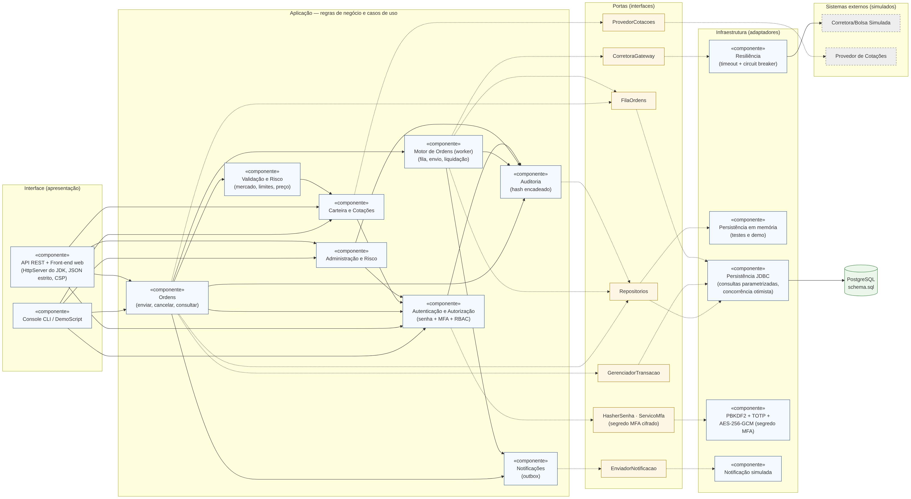

# UML — Diagrama de componentes

Arquitetura **hexagonal** (portas e adaptadores): o núcleo de regras de negócio depende apenas de **interfaces (portas)**;
banco, corretora, provedor de cotações, notificação e criptografia são **adaptadores** trocáveis. Isso permite testar
toda a regra de negócio sem banco nem rede, e trocar memória por PostgreSQL sem alterar uma linha de regra.

Fonte: [`componentes.mmd`](componentes.mmd)

## Decisões e riscos tratados

| Fronteira | Risco | Tratamento |
|---|---|---|
| Aplicação ↔ Corretora | Lentidão, queda, resposta duplicada | Porta `CorretoraGateway` + decorator de resiliência; fila durável; idempotência nas duas pontas |
| Aplicação ↔ Provedor de cotações | Dado errado, atrasado ou indisponível | Revalidação, cache com validade, bloqueio de ordens com cotação velha |
| Aplicação ↔ Banco | Concorrência, falha no meio da operação | Transação única por caso de uso; `versao` otimista; `ON CONFLICT DO NOTHING` na idempotência |
| Aplicação ↔ Notificação | Falha de envio não pode desfazer ordem | *Outbox*: grava na transação, envia depois |
| Interface (console e web) ↔ Aplicação | Entrada maliciosa, acesso indevido, cliente web comprometido | Validação por allowlist e RBAC **no servidor** (as interfaces são finas). Na API: JSON plano estrito, corpo ≤ 16 KB, token em `Authorization`, sem CORS, CSP restritiva; o front-end nunca insere dados como HTML |
| Aplicação ↔ Banco (segredo MFA) | Vazamento do banco expõe segredos TOTP | Segredo cifrado com AES-256-GCM; a chave fica fora do banco (variável de ambiente / cofre) |
