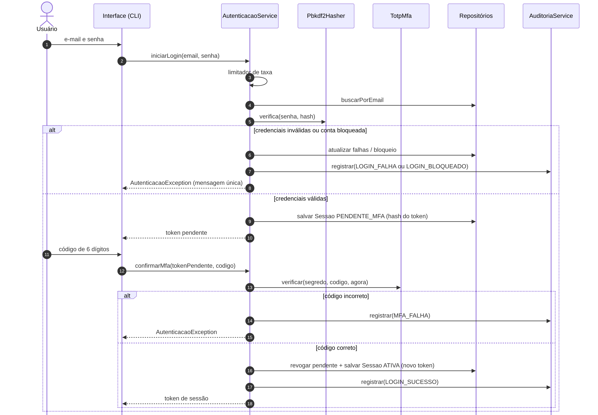
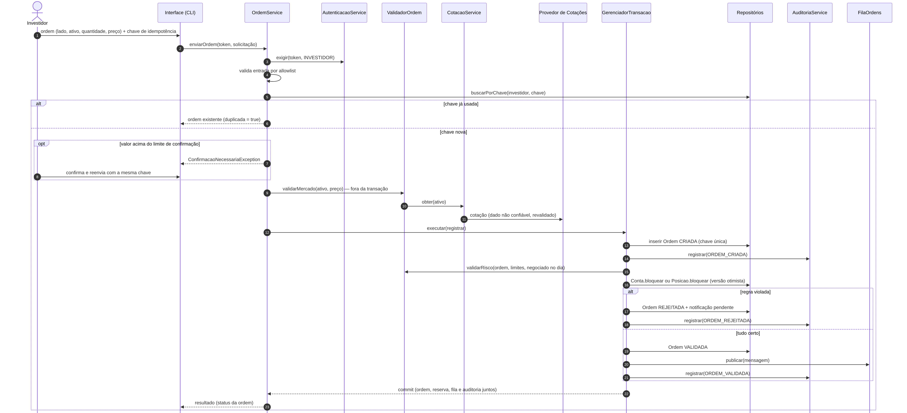
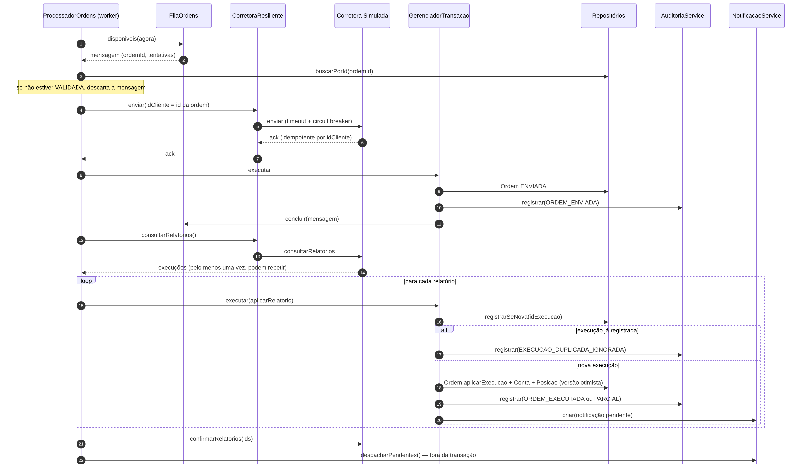
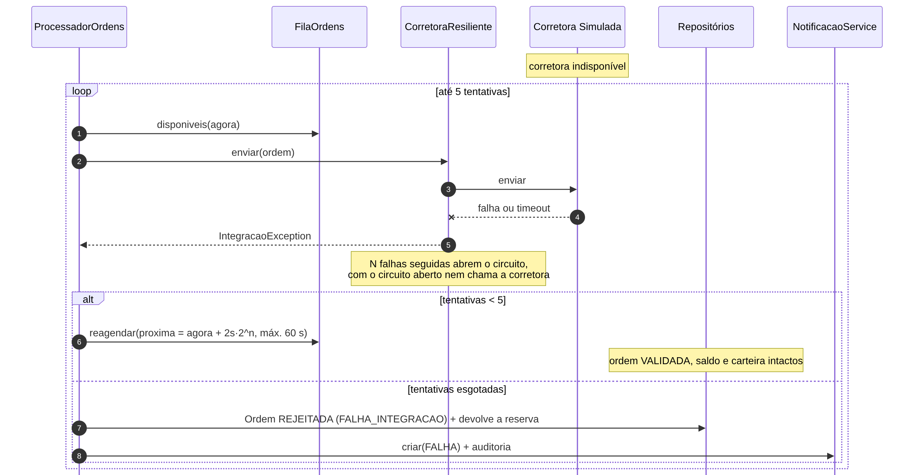
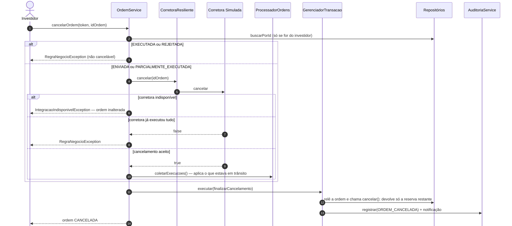
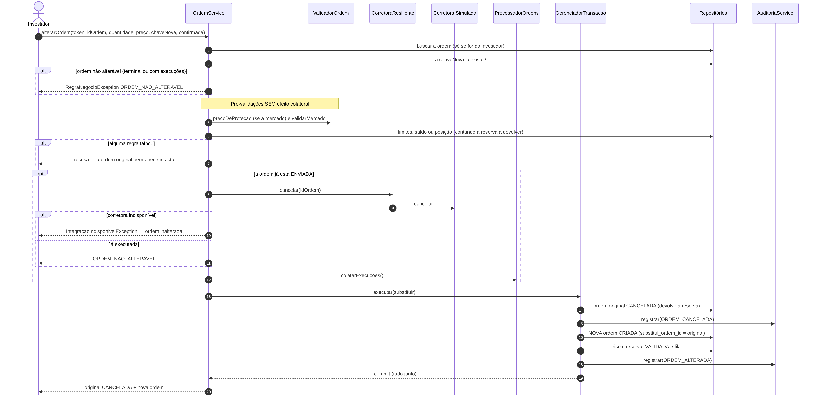

# UML — Diagramas de sequência

Fontes em Mermaid (`*.mmd`); exportações em `diagrams/`.

## 1. Login com MFA (UC01)

Fonte: [`login-mfa.mmd`](login-mfa.mmd)

## 2. Enviar ordem — compra ou venda (UC05/UC06)
Observe: a consulta ao provedor de cotações acontece **antes** de abrir a transação, e ordem, reserva, fila e auditoria confirmam **juntas**.

Fonte: [`enviar-ordem.mmd`](enviar-ordem.mmd)

## 3. Processar transmissão e execuções (UC12/UC17)
Entrega "pelo menos uma vez" da corretora + consumidor idempotente.

Fonte: [`processar-execucao.mmd`](processar-execucao.mmd)

## 4. Falha da corretora com retentativa (RN07, RN19)

Fonte: [`falha-corretora.mmd`](falha-corretora.mmd)

## 5. Cancelar ordem (UC13)

Fonte: [`cancelar-ordem.mmd`](cancelar-ordem.mmd)

## 6. Alterar ordem — cancelar e substituir (UC25)

Fonte: [`alterar-ordem.mmd`](alterar-ordem.mmd)
