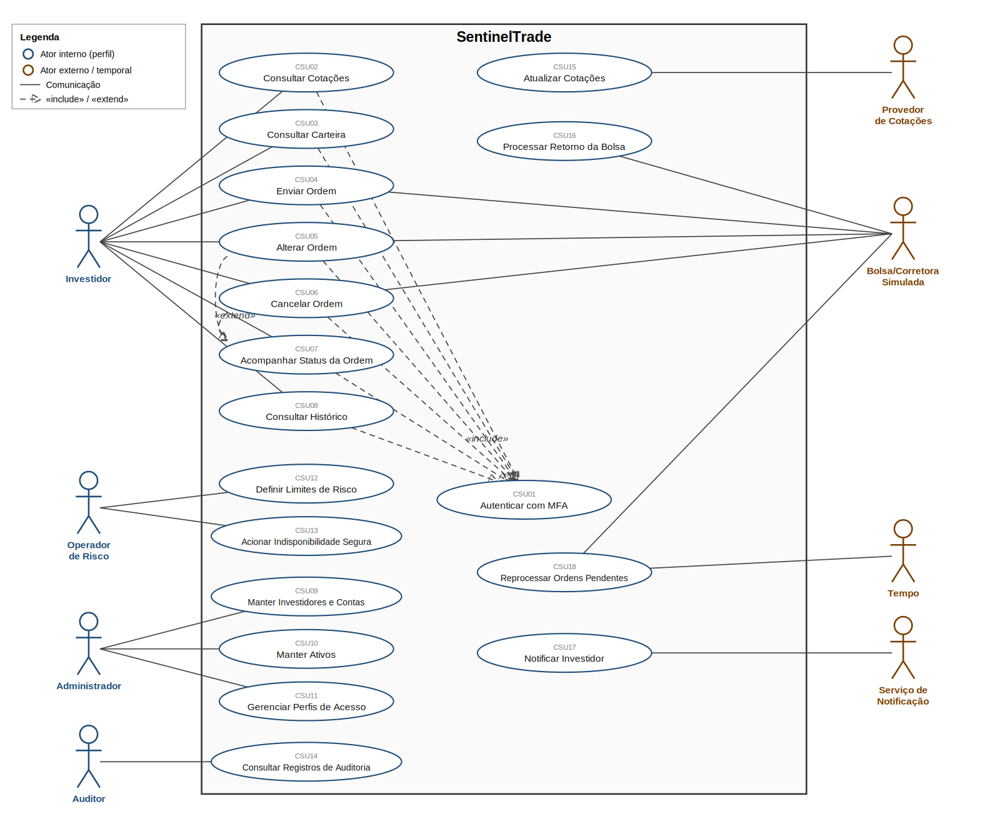

# 02 — Modelo de Casos de Uso do SentinelTrade

Método: Bezerra, *Princípios de Análise e Projeto de Sistemas com UML*, cap. 4.
Nível: descrições **essenciais** (sem citar tecnologia, por exemplo "código de uso único" e não "SMS") e **expandidas**, conforme seção 4.6.1 do livro para a fase de análise.

Diagrama: [`diagramas/casos-de-uso.png`](diagramas/casos-de-uso.png)

---

## 1. Atores

Nomeados pelo **papel**, nunca pela pessoa.

| Ator | Tipo | Descrição |
|---|---|---|
| Investidor | Primário | Pessoa com conta na Orion Capital que consulta cotações e carteira, envia, altera e cancela ordens e consulta o histórico. |
| Operador de Risco | Primário | Funcionário da corretora que define limites financeiros e aciona a indisponibilidade segura. |
| Administrador | Primário | Funcionário responsável pelos cadastros de investidores, contas, ativos e perfis de acesso. |
| Auditor | Primário | Profissional (interno ou regulatório) que consulta os registros de auditoria para verificar conformidade. |
| Provedor de Cotações | Secundário (sistema externo) | Sistema simulado que envia cotações em tempo quase real. |
| Bolsa/Corretora Simulada | Secundário (sistema externo) | Sistema simulado que recebe ordens e devolve execução, rejeição ou cancelamento. |
| Serviço de Notificação | Secundário (sistema externo) | Sistema simulado que entrega mensagens ao investidor. |
| Tempo | Ator temporal | Representa a passagem do tempo que dispara tarefas automáticas sem iniciativa de pessoa (seção 4.3.2.1, figura 4-8). |

---

## 2. Lista de casos de uso

Casos de uso representam **objetivos completos** do ator.. Por isso "validar ordem" e "registrar auditoria" não são casos de uso: fazem parte dos fluxos de Enviar Ordem e demais casos.

| ID | Caso de uso | Ator primário | Atores secundários | Tipo (seção 4.3.2) | Requisitos |
|---|---|---|---|---|---|
| CSU01 | Autenticar com MFA | Investidor (e demais perfis) | — | Incluso | RF-01 |
| CSU02 | Consultar Cotações | Investidor | — | Primário | RF-05 |
| CSU03 | Consultar Carteira | Investidor | — | Primário | RF-07 |
| CSU04 | Enviar Ordem | Investidor | Bolsa Simulada | Primário | RF-08, RF-09, RF-12, RF-20 |
| CSU05 | Alterar Ordem | Investidor | Bolsa Simulada | Primário (oposto/sucessor) | RF-11 |
| CSU06 | Cancelar Ordem | Investidor | Bolsa Simulada | Primário (caso "oposto") | RF-10 |
| CSU07 | Acompanhar Status da Ordem | Investidor | — | Primário | RF-13 |
| CSU08 | Consultar Histórico de Operações | Investidor | — | Primário | RF-16 |
| CSU09 | Manter Investidores e Contas | Administrador | — | Secundário (cadastro) | RF-03 |
| CSU10 | Manter Ativos | Administrador | — | Secundário (cadastro) | RF-04 |
| CSU11 | Gerenciar Perfis de Acesso | Administrador | — | Secundário (usuários e perfis) | RF-02 |
| CSU12 | Definir Limites de Risco | Operador de Risco | — | Primário | RF-18 |
| CSU13 | Acionar Indisponibilidade Segura | Operador de Risco | — | Primário | RF-19 |
| CSU14 | Consultar Registros de Auditoria | Auditor | — | Primário | RF-17 |
| CSU15 | Atualizar Cotações | Provedor de Cotações | — | Condição externa | RF-06 |
| CSU16 | Processar Retorno da Bolsa | Bolsa Simulada | Serviço de Notificação | Condição externa | RF-12, RF-13, RF-14 |
| CSU17 | Notificar Investidor | Serviço de Notificação | — | Condição interna | RF-15 |
| CSU18 | Reprocessar Ordens Pendentes | Tempo | Bolsa Simulada | Temporal | RF-21 |

### Relacionamentos usados 

- **`«include»` Autenticar com MFA**: todo caso de uso do Investidor exige a sequência de autenticação, que está presente em todos os seus cenários. Os perfis internos também se autenticam (precondição de CSU09 a CSU14), mas as linhas foram omitidas do diagrama para manter a legibilidade.
- **`«extend»` Acompanhar Status da Ordem**: enquanto acompanha uma ordem, o investidor pode, **opcionalmente**, alterá-la (CSU05) ou cancelá-la (CSU06). Ambos continuam existindo como casos de uso independentes.
- **Generalização**: não foi usada; nenhum par de atores ou casos de uso tem comportamento semelhante o bastante.
- **Auditoria**: por ser transversal, o registro no log imutável (RF-17) aparece como **pós-condição** de cada caso de uso, e não como relacionamento, para evitar dezenas de linhas no diagrama.

---

## 3. Descrições expandidas

Sumário, atores, precondições, fluxos, pós-condições, regras de negócio.

### CSU01 — Autenticar com MFA

**Sumário:** O usuário comprova sua identidade com credenciais e um segundo fator para obter acesso às funcionalidades do seu perfil.
**Ator primário:** Usuário (Investidor, Operador de Risco, Administrador ou Auditor)
**Precondições:** O usuário está cadastrado e ativo.

**Fluxo principal**
1. O Usuário informa sua identificação e senha.
2. O Sistema verifica as credenciais.
3. O Sistema solicita o segundo fator de autenticação.
4. O Usuário informa o código de uso único.
5. O Sistema valida o código, concede o acesso conforme o perfil e o caso de uso termina.

**Fluxo alternativo (4): Segundo fator expirado**
a. Se o código expirou, o Sistema informa o fato e oferece a emissão de novo código.
b. O Usuário solicita novo código e o caso de uso retorna ao passo 4.

**Fluxo de exceção (2): Credenciais inválidas**
a. O Sistema informa "credenciais inválidas" sem indicar qual dado está errado e registra a tentativa.
b. Se o limite de tentativas foi atingido (RN11), o Sistema bloqueia a conta temporariamente e o caso de uso termina; caso contrário, retorna ao passo 1.

**Fluxo de exceção (4): Código inválido**
a. O Sistema informa a falha, registra a tentativa e aplica RN11; retorna ao passo 4 ou termina conforme o limite.

**Pós-condições:** O usuário obteve sessão com as permissões do seu perfil, ou permaneceu sem acesso. Toda tentativa foi registrada na auditoria.
**Regras de negócio:** RN10, RN11

---

### CSU04 — Enviar Ordem

**Sumário:** O Investidor solicita a compra ou a venda de um ativo e o Sistema a valida e a encaminha à Bolsa simulada.
**Ator primário:** Investidor
**Atores secundários:** Bolsa Simulada
**Precondições:** O Investidor está identificado (Include CSU01).

**Fluxo principal**
1. O Investidor escolhe o ativo e informa tipo (compra ou venda), modalidade (a mercado ou limitada), quantidade e, se limitada, o preço.
2. O Sistema exibe um resumo com valor total estimado para conferência.
3. O Investidor confirma a ordem.
4. O Sistema atribui à ordem um identificador único e uma chave de idempotência (RN08).
5. O Sistema valida a ordem: quantidade e lote (RN05), preço (RN06), cotação atual (RN07), situação do mercado (RN04), saldo ou posição (RN01, RN02) e limites de risco (RN03).
6. O Sistema muda o estado da ordem para **Validada**, registra-a e informa ao Investidor que foi aceita.
7. O Sistema transmite a ordem à Bolsa Simulada e muda o estado para **Enviada**.
8. O Sistema exibe o identificador da ordem para acompanhamento (CSU07) e o caso de uso termina.

**Fluxo alternativo (3): Investidor desiste**
a. O Investidor cancela antes de confirmar e o caso de uso termina sem criar ordem.

**Fluxo alternativo (2): Ordem a mercado sem preço**
a. Para ordem a mercado, o Sistema exibe o último preço conhecido como referência e segue para o passo 3.

**Fluxos de exceção (5): Validação reprovada**
a. **Saldo ou posição insuficiente** (RN01/RN02): o Sistema rejeita a ordem, informa o motivo e o valor disponível.
b. **Limite de risco excedido** (RN03): o Sistema rejeita e informa o limite.
c. **Mercado fechado ou ativo suspenso** (RN04): o Sistema rejeita e informa o próximo horário de negociação.
d. **Lote, quantidade ou preço inválidos** (RN05, RN06): o Sistema informa o erro e o caso de uso retorna ao passo 1.
e. **Cotação desatualizada** (RN07): o Sistema recusa a ordem a mercado e sugere ordem limitada.
Em a, b e c, a ordem fica no estado **Rejeitada**, o Investidor é notificado (CSU17) e o caso de uso termina.

**Fluxo de exceção (4): Ordem duplicada**
a. Se já existe ordem com a mesma chave (RN08), o Sistema não cria outra, devolve o resultado da ordem original e o caso de uso termina.

**Fluxo de exceção (2): Indisponibilidade segura ativa**
a. Se o modo de indisponibilidade segura está ativo (CSU13), o Sistema recusa a ordem, informa que novas ordens estão temporariamente suspensas e o caso de uso termina.

**Fluxo de exceção (7): Bolsa sem resposta**
a. Se a Bolsa não responde dentro do tempo limite, o Sistema muda a ordem para **Falha**, informa o Investidor de que a situação está pendente e encaminha a ordem para reprocessamento (CSU18). O caso de uso termina.

**Pós-condições:** Uma ordem foi criada em estado Enviada, Rejeitada ou Falha; nunca duas ordens para a mesma chave. O evento foi registrado na auditoria.
**Regras de negócio:** RN01 a RN08, RN13

---

### CSU05 — Alterar Ordem

**Sumário:** O Investidor altera preço ou quantidade de uma ordem ainda não totalmente executada.
**Ator primário:** Investidor · **Atores secundários:** Bolsa Simulada
**Precondições:** O Investidor está identificado e possui ordem em estado alterável (RN09).

**Fluxo principal**
1. O Investidor seleciona a ordem e solicita alteração.
2. O Sistema exibe os dados atuais da ordem.
3. O Investidor informa o novo preço e/ou a nova quantidade.
4. O Sistema revalida a ordem com os novos dados (mesmas regras do passo 5 de CSU04).
5. O Sistema encaminha a alteração à Bolsa Simulada e informa o Investidor.
6. O Sistema registra a alteração e o caso de uso termina.

**Fluxo de exceção (1): Ordem não alterável**
a. Se a ordem já está Executada, Cancelada ou Rejeitada (RN09), o Sistema informa o fato e o caso de uso termina.

**Fluxo de exceção (4): Validação reprovada**
a. O Sistema informa o motivo, mantém a ordem original e retorna ao passo 3.

**Fluxo de exceção (5): Execução ocorreu durante a alteração**
a. Se a Bolsa informa que a ordem foi executada antes da alteração, o Sistema mantém o resultado da execução, informa o Investidor e o caso de uso termina.

**Pós-condições:** A ordem foi alterada (nova versão registrada) ou permaneceu inalterada.
**Regras de negócio:** RN01 a RN07, RN09

---

### CSU06 — Cancelar Ordem

**Sumário:** O Investidor cancela uma ordem que ainda não foi totalmente executada.
**Ator primário:** Investidor · **Atores secundários:** Bolsa Simulada
**Precondições:** O Investidor está identificado e possui ordem em estado cancelável (RN09).

**Fluxo principal**
1. O Investidor seleciona a ordem e solicita o cancelamento.
2. O Sistema pede confirmação, exibindo a parte já executada, se houver.
3. O Investidor confirma.
4. O Sistema solicita o cancelamento à Bolsa Simulada.
5. A Bolsa confirma o cancelamento.
6. O Sistema muda o estado para **Cancelada**, libera o saldo ou a quantidade reservados, notifica o Investidor (CSU17) e o caso de uso termina.

**Fluxo alternativo (3): Investidor desiste**
a. O Investidor não confirma e a ordem permanece como estava.

**Fluxo de exceção (1): Ordem não cancelável**
a. Se a ordem já está Executada, Cancelada ou Rejeitada (RN09), o Sistema informa o fato e o caso de uso termina.

**Fluxo de exceção (5): Bolsa recusa o cancelamento**
a. Se a ordem foi executada antes do cancelamento, o Sistema mantém o resultado da execução e informa o Investidor.

**Fluxo de exceção (4): Bolsa sem resposta**
a. O Sistema marca o cancelamento como **pendente**, informa o Investidor e encaminha para reprocessamento (CSU18). A ordem continua ativa até a confirmação.

**Pós-condições:** A ordem foi cancelada, teve cancelamento pendente ou permaneceu ativa; saldo e posição permanecem consistentes.
**Regras de negócio:** RN09, RN13

---

### CSU13 — Acionar Indisponibilidade Segura

**Sumário:** O Operador de Risco suspende temporariamente o recebimento de novas ordens, mantendo consultas ativas, para conter o impacto de uma falha ou anomalia.
**Ator primário:** Operador de Risco
**Precondições:** O Operador de Risco está identificado.

**Fluxo principal**
1. O Operador de Risco solicita a suspensão de novas ordens, informando o motivo e se a suspensão vale para todo o mercado ou para um ativo.
2. O Sistema pede confirmação, informando o número de ordens ainda em andamento.
3. O Operador confirma.
4. O Sistema ativa a suspensão, passa a recusar novas ordens com mensagem clara e mantém as consultas e os cancelamentos disponíveis.
5. O Sistema registra o acionamento e o caso de uso termina.

**Fluxo alternativo (1): Encerrar suspensão**
a. O Operador solicita o fim da suspensão; o Sistema verifica que os componentes estão saudáveis, reabre o recebimento de ordens e registra o fato.

**Fluxo de exceção (a qualquer momento): Falha grave detectada pelo Sistema**
a. Se o Sistema detecta falha que impede a validação segura, ele ativa a suspensão sozinho, notifica o Operador de Risco e registra o evento.

**Pós-condições:** O Sistema está em modo de indisponibilidade segura ou operando normalmente; a mudança foi auditada.

---

### CSU14 — Consultar Registros de Auditoria

**Sumário:** O Auditor consulta registros de eventos para verificar a conformidade e a integridade das operações.
**Ator primário:** Auditor
**Precondições:** O Auditor está identificado.

**Fluxo principal**
1. O Auditor solicita a consulta de registros.
2. O Sistema apresenta os filtros: período, usuário, tipo de evento e identificador da ordem.
3. O Auditor informa os filtros.
4. O Sistema exibe os registros encontrados, em ordem cronológica.
5. O Auditor solicita a verificação de integridade do período.
6. O Sistema informa se a sequência de registros está íntegra e o caso de uso termina.

**Fluxo de exceção (4): Nenhum registro**
a. O Sistema informa que não há registros para os filtros e retorna ao passo 3.

**Fluxo de exceção (6): Inconsistência detectada**
a. O Sistema destaca os registros suspeitos, registra o alerta e notifica o Operador de Risco.

**Pós-condições:** O Auditor obteve as informações; a própria consulta foi registrada na auditoria.
**Regras de negócio:** RN12

---

### CSU16 — Processar Retorno da Bolsa

**Sumário:** O Sistema recebe da Bolsa Simulada a execução, rejeição ou cancelamento de uma ordem e atualiza ordem, saldo e posição.
**Ator primário:** Bolsa Simulada · **Atores secundários:** Serviço de Notificação
**Precondições:** Existe ordem em estado Enviada ou Parcialmente Executada.

**Fluxo principal**
1. A Bolsa informa o resultado de uma ordem (execução total, execução parcial, rejeição ou cancelamento).
2. O Sistema verifica que a mensagem é válida e que ainda não foi processada.
3. O Sistema atualiza o estado da ordem (Executada, Parcialmente Executada, Rejeitada ou Cancelada).
4. Em caso de execução, o Sistema registra a operação e atualiza saldo e posição do Investidor de forma consistente.
5. O Sistema aciona a notificação do Investidor (CSU17) e registra o evento.
6. O caso de uso termina.

**Fluxo de exceção (2): Mensagem repetida**
a. Se a mensagem já foi processada, o Sistema a ignora, confirma o recebimento e o caso de uso termina (sem alterar saldo duas vezes).

**Fluxo de exceção (2): Mensagem inválida ou ordem desconhecida**
a. O Sistema descarta a mensagem, registra a ocorrência e alerta o Operador de Risco.

**Fluxo de exceção (4): Falha ao gravar**
a. O Sistema desfaz a atualização parcial, mantém a mensagem para nova tentativa e registra a falha.

**Pós-condições:** Ordem, operação, saldo e posição refletem o retorno da Bolsa, uma única vez.
**Regras de negócio:** RN08, RN09

---

### CSU18 — Reprocessar Ordens Pendentes

**Sumário:** Periodicamente, o Sistema retoma ordens e cancelamentos que ficaram sem confirmação da Bolsa.
**Ator primário:** Tempo · **Atores secundários:** Bolsa Simulada
**Precondições:** Existem ordens em estado Falha ou com cancelamento pendente.

**Fluxo principal**
1. O Tempo aciona o reprocessamento no intervalo configurado.
2. O Sistema seleciona as ordens pendentes que ainda não atingiram o número máximo de tentativas.
3. Para cada ordem, o Sistema consulta a Bolsa para saber se ela já foi recebida.
4. Se a Bolsa não a conhece, o Sistema a reenvia com a mesma chave de idempotência; se conhece, apenas atualiza o estado.
5. O Sistema registra cada tentativa e o caso de uso termina.

**Fluxo de exceção (4): Limite de tentativas atingido**
a. O Sistema marca a ordem para **intervenção manual**, notifica o Investidor (CSU17) e o Operador de Risco, e registra o fato.

**Fluxo de exceção (3): Bolsa indisponível**
a. O Sistema suspende o ciclo, agenda nova tentativa com espera crescente e, se a indisponibilidade persistir, sugere a CSU13 ao Operador de Risco.

**Pós-condições:** Cada ordem pendente foi resolvida, continua pendente com tentativa registrada ou foi encaminhada para intervenção manual.
**Regras de negócio:** RN08

---

## 4. Descrições sucintas dos demais casos de uso

| ID | Sumário | Fluxo principal (resumo) | Exceções principais |
|---|---|---|---|
| CSU02 Consultar Cotações | O Investidor visualiza preço, variação e volume dos ativos. | Investidor escolhe ativos → Sistema exibe cotações com horário da atualização. | Cotação desatualizada: Sistema sinaliza a defasagem. |
| CSU03 Consultar Carteira | O Investidor visualiza saldo, posições, preço médio e resultado. | Investidor solicita → Sistema exibe posição consolidada e por ativo. | Sem posições: Sistema informa carteira vazia. |
| CSU07 Acompanhar Status da Ordem | O Investidor vê o estado atual e o histórico de estados de uma ordem. | Investidor seleciona ordem → Sistema exibe estado, quantidade executada e eventos. | Ordem inexistente ou de outro investidor (RN13): acesso negado. |
| CSU08 Consultar Histórico de Operações | O Investidor consulta ordens e operações passadas. | Investidor informa período, ativo e status → Sistema lista resultados. | Nenhum resultado: Sistema informa. |
| CSU09 Manter Investidores e Contas | O Administrador inclui, altera, consulta e desativa investidores, contas e carteiras. | Administrador escolhe operação → informa dados → Sistema valida e grava. | Dados inválidos ou duplicados: Sistema rejeita. Investidor com ordens ativas não pode ser desativado. |
| CSU10 Manter Ativos | O Administrador inclui, altera, consulta e suspende ativos negociáveis. | Administrador escolhe operação → informa código, lote e situação → Sistema valida e grava. | Código duplicado: Sistema rejeita. |
| CSU11 Gerenciar Perfis de Acesso | O Administrador atribui e revoga perfis de usuários. | Administrador seleciona usuário → define perfil → Sistema grava e audita. | Tentativa de conceder perfil acima da própria alçada: Sistema nega. |
| CSU12 Definir Limites de Risco | O Operador de Risco define limites por investidor, ordem e dia. | Operador seleciona investidor → informa limites → Sistema valida e grava. | Limite acima do teto da corretora: Sistema rejeita. |
| CSU15 Atualizar Cotações | O Sistema recebe e registra cotações do provedor. | Provedor envia cotação → Sistema valida → atualiza a última cotação do ativo. | Cotação inválida ou fora de ordem: descartada e registrada; provedor sem resposta: Sistema sinaliza dados desatualizados. |
| CSU17 Notificar Investidor | O Sistema avisa o Investidor sobre execução, rejeição, cancelamento ou falha. | Sistema monta mensagem → Serviço de Notificação entrega → Sistema registra o envio. | Falha na entrega: nova tentativa controlada; o aviso permanece disponível na própria plataforma. |
