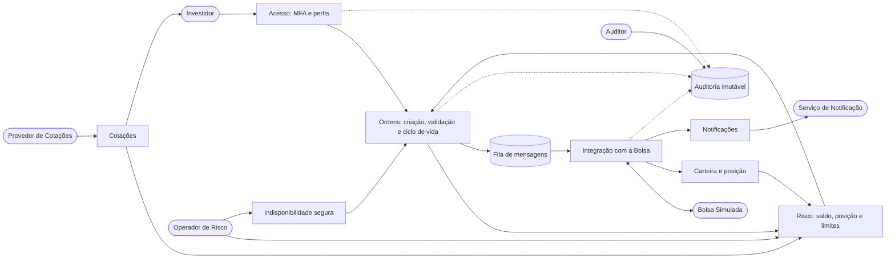

# 03 — Visão sistêmica do SentinelTrade

O enunciado pede que a equipe siga o **pensamento sistêmico**: enxergar o SentinelTrade como um conjunto de partes que dependem umas das outras e de um ambiente externo, e não como uma lista de telas. Este documento registra como isso guiou o projeto.

---

## 1. O sistema, suas partes e seu ambiente

**Leitura do diagrama:** o fluxo principal vai do investidor à Bolsa, mas o risco realimenta a criação de ordens (uma ordem aceita reduz o saldo disponível para a próxima), a carteira realimenta o risco, e a auditoria observa todas as partes. Nenhum módulo funciona isolado.

---

## 2. Princípios sistêmicos aplicados

| Princípio | Como aparece no projeto |
|---|---|
| **Fronteira clara** | O diagrama de casos de uso separa o que é do sistema (elipses) do que é ambiente (atores). Provedor de cotações, Bolsa e serviço de notificação são externos e **podem falhar**. |
| **Interdependência** | Cotação desatualizada afeta a validação de ordem a mercado (RN07); saldo afeta a validação (RN01); execução afeta saldo e posição (CSU16). |
| **Realimentação (feedback)** | Execuções atualizam carteira e saldo, que passam a limitar as próximas ordens; o limite diário (RN03) é consumido a cada operação. |
| **Efeitos em cadeia** | Uma falha na Bolsa gera ordens em estado Falha, reprocessamento e, em último caso, intervenção manual; não basta "mostrar erro". |
| **Comportamento emergente** | Reenvio pelo usuário somado a retentativa automática poderia duplicar ordens; o problema só aparece na combinação e por isso a idempotência é requisito (RF-20, RNF-08, RNF-13). |
| **Falha segura (fail-safe)** | Quando não é possível validar com segurança, o sistema **recusa** ordens (RF-19, RNF-15), em vez de aceitar sem garantia. |
| **Visão do todo antes das partes** | Os casos de uso foram definidos a partir de objetivos dos atores, e cada requisito foi ligado a um caso de uso (matriz em `01-requisitos.md`). |

---

## 3. Cenários de falha e respostas do sistema

| Cenário de falha | Risco se nada for feito | Resposta projetada | Requisitos |
|---|---|---|---|
| Bolsa não responde após o envio | Investidor não sabe se a ordem existe; risco de reenviar | Time-out, estado Falha, consulta à Bolsa antes de reenviar, mesma chave de idempotência | RNF-11, RNF-12, RNF-13, CSU18 |
| Investidor clica duas vezes em "confirmar" | Ordem duplicada e prejuízo financeiro | Chave de idempotência; segunda requisição devolve o resultado da primeira | RF-20, RNF-08, RN08 |
| Retorno da Bolsa chega duas vezes | Saldo debitado duas vezes | Processamento idempotente do retorno (CSU16, fluxo de exceção) | RNF-13, RNF-17 |
| Provedor de cotações cai ou atrasa | Ordem a mercado com preço defasado | Bloqueio de ordem a mercado com cotação velha; sinalização no CSU02 | RN07, RNF-11 |
| Falha no banco no meio da execução | Ordem executada sem atualizar saldo | Transação única (tudo ou nada) e reprocessamento da mensagem | RNF-17, RNF-14 |
| Componente de validação indisponível | Ordens sem validação de risco | Modo de indisponibilidade segura: novas ordens bloqueadas, consultas mantidas | RF-19, RNF-15 |
| Notificação não é entregue | Investidor desinformado | Fila com nova tentativa; aviso também fica visível na plataforma | RNF-14, CSU17 |
| Alteração de logs por usuário privilegiado | Perda de prova para auditoria | Log append-only com encadeamento por hash; nem o Administrador altera | RN12, RNF-18, RNF-20 |
| Tentativa de invasão (força bruta) | Acesso indevido a contas | MFA, bloqueio após tentativas, hash de senha | RNF-01, RNF-02, RN11 |
| Entrada maliciosa (injeção) | Vazamento ou corrupção de dados | Validação de entradas e consultas parametrizadas | RNF-05, RNF-07 |

---

## 4. Como as categorias de requisitos se conectam

| Categoria | Pergunta que responde | Depende de |
|---|---|---|
| Funcionais | O que o sistema faz? | Regras de negócio (RN) |
| Segurança | Quem pode fazer, e o que impede abuso? | Perfis, auditoria |
| Resiliência | O que acontece quando algo falha? | Fila, idempotência, estados da ordem |
| Qualidade | Como provar que funciona e é confiável? | Auditoria, testes, métricas |

Exemplo de cadeia: **idempotência** (resiliência) sustenta a **prevenção de duplicidade** (funcional), que protege a **integridade** (qualidade) e depende da **auditoria** para ser comprovada.

---

## 5. Autoavaliação da equipe (checklist)

- [x] Identificamos atores externos e o que acontece quando eles falham.
- [x] Cada requisito está ligado a pelo menos um caso de uso.
- [x] Cada risco relevante tem requisito ou fluxo de exceção correspondente.
- [x] Os estados da ordem e suas transições estão definidos (`diagramas/ciclo-de-vida-ordem.md`).
- [x] A segurança é tratada como propriedade do sistema inteiro, não de uma tela.
- [ ] Validar as metas numéricas (tempos, percentuais) com o professor.
- [ ] Transformar este modelo em diagramas de classes e sequência nas próximas etapas.
