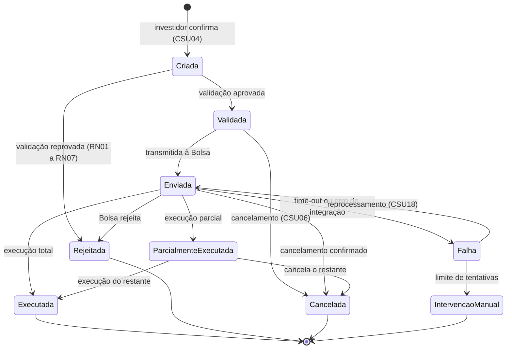

# Ciclo de vida da ordem (diagrama de estados)

Estados em que a ordem pode ser **alterada ou cancelada** (RN09): Validada, Enviada e Parcialmente Executada.
Estados finais: Executada, Rejeitada, Cancelada e Intervenção Manual.
